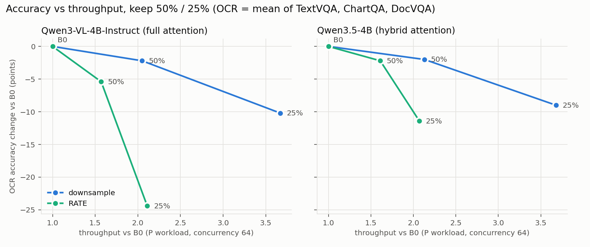
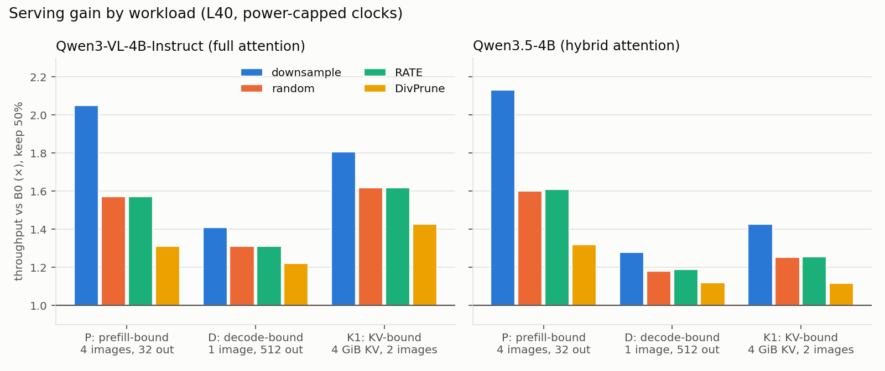

# vlm-token-serve

**English** | [中文](#中文)

A single 896×896 image turns into about 780 tokens inside a vision-language model, more than ten times the length of a typical question. Many papers shrink this number and report the accuracy they keep. This repository asks the next question: **when the model is actually served with [vLLM](https://github.com/vllm-project/vllm), does sending fewer image tokens make serving faster, where does the speed-up come from, and how large is it?**

It contains a vLLM plugin that compresses image tokens, a benchmark tool that measures the effect under realistic load, and the reports of every experiment.

**Short answer** (Qwen3-VL-4B-Instruct and Qwen3.5-4B, one NVIDIA L40):

- **Shrinking the image beats dropping tokens.** At the same token budget, resizing the image before the vision encoder loses less accuracy on OCR-heavy tasks and gives more throughput (up to 2.1× against 1.6×) than selecting tokens after the encoder. Dropping tokens is ahead only on small scene text with Qwen3.5.
- **The bottleneck decides where the gain shows up, and the model's attention design decides how big it is.** When KV-cache memory is the limit, halving the image tokens lets the full-attention model serve 1.75× more requests at once, but the hybrid-attention model only 1.27×.
- **Engineering details change the result.** A slow token-selection step ate about half of DivPrune's throughput gain until a single Triton kernel made it 61× faster.

## 1. Two ways to send fewer image tokens

A request with an image goes through four stages, and each one costs something:

| Stage | What happens | What image tokens cost here |
|---|---|---|
| Vision encoder (ViT) | turns pixels into image tokens | compute, grows with the number of pixels |
| Prefill | the language model reads the whole prompt once | compute, grows with the prompt length |
| KV cache | the model keeps every prompt token in GPU memory while it answers | memory, limits how many requests run at once |
| Decode | the model writes the answer one token at a time | each step reads the KV cache |

There are two ways to cut the number of image tokens:

- **Downsample**: resize the image before the vision encoder. Every later stage gets cheaper, including the encoder itself.
- **Prune**: run the encoder on the full image, then keep only some of its output tokens. This repository implements random selection, 2×2 pooling, [DivPrune](https://github.com/vbdi/divprune) (keeps the most diverse tokens) and RATE from vLLM PR [#60963](https://github.com/vllm-project/vllm/pull/60963). Pruning can pick the informative tokens, but the encoder still runs at full cost.

Both are compared at the same token budget (keep 50%, 25% and 12.5% of the tokens) against the same model without compression (called B0).

## 2. How it was measured

- **Two models with different attention designs.** Qwen3-VL-4B-Instruct uses full attention in every layer, so every token stays in the KV cache in every layer. Qwen3.5-4B is a hybrid: only 8 of its 32 layers use full attention, the rest keep a fixed-size state. One token costs 144 KiB of KV cache in Qwen3-VL and 32 KiB in Qwen3.5.
- **Accuracy** on ChartQA, TextVQA and DocVQA (the OCR average below), plus MME and MMBench, through the same `vllm serve` path that serves traffic. Each method is compared with its own model's B0 question by question, with paired bootstrap 95% confidence intervals.
- **Three serving workloads**, each built to hit one bottleneck. **P**: 4 images and a short answer, limited by prefill compute. **D**: 1 image and a 512-token answer, limited by decode. **K1**: a fixed 4 GiB KV cache, limited by memory.
- **Hypotheses and pass criteria were written down before each run** ([`docs/plans/`](docs/plans/)). The reports state each verdict, including the hypotheses that turned out false.
- Hardware note: under sustained load the L40 hits its 300 W power cap and its clock drops from about 2250 to 1550 MHz ([FOLLOWUP3](docs/results/FOLLOWUP3_RESULTS.md)). All throughput numbers are measured in this state, which is how the card behaves in production.

## 3. Findings

### 3.1 Accuracy: downsampling loses the least on OCR tasks

Change of the OCR average against B0, in points ([W3](docs/results/W3_RESULTS.md)):

| Model | Method | keep 50% | keep 25% | keep 12.5% |
|---|---|---|---|---|
| Qwen3-VL-4B-Instruct | downsample | **−2.2** | **−10.2** | **−22.5** |
| | RATE | −5.4 | −24.4 | −41.1 |
| | DivPrune | −6.3 | −18.5 | −34.8 |
| | random | −8.7 | −26.2 | −44.1 |
| Qwen3.5-4B | downsample | **−2.0** | **−9.0** | **−21.7** |
| | RATE | −2.2 | −11.4 | −31.9 |
| | DivPrune | −4.8 | −15.7 | −31.3 |
| | random | −11.9 | −32.8 | −49.4 |

A likely reason, not tested directly: charts and documents have large, dense text, and a smaller image keeps all of it, slightly blurred, while pruning removes whole regions that sometimes hold the answer. Pruning wins in one case: on TextVQA, where the text is a small part of a natural photo, RATE at keep 50% on Qwen3.5 changes accuracy by −0.4 [−1.2, +0.5] against −2.6 [−3.9, −1.3] for downsampling.

### 3.2 When compute is the bottleneck, pruning still pays for the vision encoder

In a single request the vision encoder takes about a quarter of the time to the first token. Pruning runs it on the full image, so that quarter does not shrink ([W4 §1](docs/results/W4_RESULTS.md)). Under full load on the prefill-bound workload P (concurrency 64, keep 50%), the gap shows up as throughput ([W4 §5](docs/results/W4_RESULTS.md)):

| | downsample | random, RATE | DivPrune |
|---|---|---|---|
| Throughput vs B0 | 1.94–2.13× | 1.49–1.63× | 1.19–1.32× |

Putting accuracy and throughput together, downsampling is on the frontier for both models. To reach the throughput of RATE at keep 25%, downsampling at keep 50% is enough and loses far less accuracy ([W4 §7](docs/results/W4_RESULTS.md)).



### 3.3 When memory is the bottleneck, the attention design decides the gain

With a fixed KV cache (workload K1, keep 50%, concurrency 128), fewer image tokens per request means more requests fit in memory at once ([W4 §3](docs/results/W4_RESULTS.md)):

| | Qwen3-VL-4B-Instruct (full attention) | Qwen3.5-4B (hybrid) |
|---|---|---|
| Requests running at once vs B0 | 1.744–1.768× | 1.267–1.280× |
| Throughput vs B0, downsample | 1.81× | 1.43× |
| Throughput vs B0, pruning | 1.43–1.62× | 1.12–1.26× |

The hybrid model gains less because three quarters of its layers keep a fixed-size state that does not grow with the prompt, so cutting tokens frees less memory. A simple block-counting model of the KV cache, written down before the runs, predicted these gains within 4% and later predicted two new settings within 0.937–1.064 of the measured value ([FOLLOWUP](docs/results/FOLLOWUP_RESULTS.md)). The same pattern appears in decoding (workload D, concurrency 64): time per output token drops by 25–28% on Qwen3-VL and by 9–15% on Qwen3.5 ([W4 §6](docs/results/W4_RESULTS.md)).



### 3.4 On the hybrid model, compression can lower the prefix-cache hit rate

In a multi-turn chat about an image, vLLM reuses the cached tokens of earlier turns. Compression makes each conversation smaller, so more conversations fit in the cache: 1.57–1.59× more on Qwen3-VL, 1.17–1.20× on Qwen3.5. The hybrid model, however, can only reuse its cache in blocks of 528 tokens. After compression the shared history of turns 1 to 3 is shorter than one block, and with 8 conversations in rotation the hit rate falls from 53% to 29% ([K2](docs/results/K2_RESULTS.md)).

### 3.5 Implementation cost matters at high load

- **Token selection can cost as much as the encoder.** The PyTorch version of DivPrune picks tokens one at a time with about 1600 small GPU kernels per image, 25.66 ms in total. A single Triton kernel does the same in 0.419 ms (61× faster). Its throughput on workload P rises from 1.28× to 1.58×, the same as random selection, with unchanged accuracy ([W5](docs/results/W5_RESULTS.md)).
- **Compression stacks with FP8 weights.** FP8 alone gives 1.45× (Qwen3-VL) and 1.56× (Qwen3.5) with no accuracy change. FP8 plus downsampling at keep 50% gives 3.05× and 3.06× ([W5](docs/results/W5_RESULTS.md)).

### 3.6 What this means in practice

Try downsampling first. On these models it gave the most throughput on every workload and the smallest loss on the OCR average. How much it buys depends on the bottleneck: about 2× when prefill compute is the limit, 1.4–1.8× when KV memory is the limit, and 1.3–1.4× when decoding is the limit. The memory-bound gain is much smaller on the hybrid-attention model. Token pruning was ahead only on small scene text with Qwen3.5. If you use it, make sure the selection step is fast. All numbers come from two 4B models on one GPU type with synthetic serving load. Other models, image sizes or hardware may shift the balance.

## 4. How the plugin works

The plugin is loaded by vLLM at start-up through its `vllm.general_plugins` entry point. It changes no vLLM code and does nothing unless `VTS_METHOD` is set.

1. **Make room for fewer tokens.** When a request arrives, the plugin shrinks each image's placeholder in the prompt to the number of tokens that will be kept. From then on the scheduler and the KV cache only ever see the smaller number. Downsampling instead resizes the image at this point.
2. **Run the vision encoder safely.** With pruning, vLLM's scheduler lets more images into one step than it measured at start-up, which can run out of GPU memory ([vllm#63187](https://github.com/vllm-project/vllm/issues/63187)). The plugin feeds the encoder in groups no larger than that measurement.
3. **Pick the tokens and put them back in place.** The selected tokens are re-inserted at their original 2D positions (M-RoPE), so the model still knows where each one sits in the image. This reuses the path vLLM built for pruning video frames.

A step-by-step walkthrough in Chinese, with line references, is in [`docs/CODE_GUIDE_zh.md`](docs/CODE_GUIDE_zh.md).

## 5. Problems found along the way

Building the plugin and the benchmark uncovered three problems in vLLM, reported upstream:

- [vllm#63187](https://github.com/vllm-project/vllm/issues/63187): with pruning on, the scheduler budgets the vision encoder by the pruned token count. One step can then send several times the measured load to the encoder and run out of memory. The plugin works around it (step 2 above).
- [vllm#62937](https://github.com/vllm-project/vllm/issues/62937): with transformers ≥ 5.10, the positions recomputed after Qwen3-VL video pruning are misaligned. With a short text prefix the server crashes, with a long one it silently uses wrong positions.
- [A comment on PR #60963](https://github.com/vllm-project/vllm/pull/60963#issuecomment-6321576342): a sort-direction bug made RATE keep the first tokens of every image instead of the selected ones. The plugin keeps both the corrected version (`rate`) and the original (`rate_pr`).

## 6. Use it

```bash
# in an environment with vllm==0.32.0
pip install --no-deps .
VTS_METHOD=downsample VTS_KEEP=0.5 vllm serve Qwen/Qwen3-VL-4B-Instruct
```

| `VTS_METHOD` | What it does |
|---|---|
| `none` | plugin off (stock vLLM) |
| `downsample` | resize each image by √keep per side before preprocessing |
| `random` | a fixed random subset of tokens |
| `pool2x2` | average each 2×2 block of tokens |
| `divprune` | keep the most diverse tokens. Add `VTS_DIVPRUNE_IMPL=triton` for the fast kernel |
| `rate` | RATE with the corrected sort direction |
| `rate_pr` | RATE exactly as first written in PR #60963 |
| `rate_orig` | RATE after the PR author's fix (`45333ba`) |

`VTS_KEEP` sets the fraction of tokens kept (default 1.0). `VTS_VIT_TRACE=<dir>` and `VTS_STEP_TRACE=<dir>` record per-call encoder timing and per-step engine timing. All options are listed in [`src/vts_plugin/config.py`](src/vts_plugin/config.py).

`vts-bench` runs the measurements above with the same protocol: a fresh server for every model and method, a discarded warm-up, and the same request seeds across methods so results can be compared request by request.

```bash
export VTS_ROOT=/path/to/root               # holds envs/vts, models/<name>, tasks_local/
export CUDA_VISIBLE_DEVICES=GPU-xxxxxxxx    # a GPU UUID; refuses to start on a busy GPU
vts-bench serve --preset P --methods none downsample random rate divprune_triton --concurrency 1 8 32 64 --out runs/p
vts-bench serve --preset K1 --kv-bytes 4294967296 --concurrency 128 --out runs/k1
vts-bench summarize serve runs/p/results    # gains vs B0, paired per repetition
vts-bench accuracy --methods none downsample --tasks vts_chartqa vts_textvqa_val --out runs/acc
```

## 7. Reproduce the results

Each report in [`docs/results/`](docs/results/) names the scripts in [`experiments/`](experiments/) that produced it, one folder per milestone, and the plan it was judged against.

| Report | What it covers | Scripts |
|---|---|---|
| [W1](docs/results/W1_RESULTS.md) | uncompressed accuracy and serving baselines | `experiments/w1/` |
| [W2](docs/results/W2_RESULTS.md) | plugin correctness, cross-check against Hugging Face transformers | `experiments/w2/` |
| [W3](docs/results/W3_RESULTS.md) | accuracy of every method at three budgets | `experiments/w3/`, `experiments/routec/` |
| [W4](docs/results/W4_RESULTS.md) | serving workloads P, D, K1 and the accuracy–throughput frontier | `experiments/w4/` |
| [W5](docs/results/W5_RESULTS.md) | Triton DivPrune and FP8 | `experiments/w5/` |
| [K2](docs/results/K2_RESULTS.md), [FOLLOWUP](docs/results/FOLLOWUP_RESULTS.md), [FOLLOWUP2](docs/results/FOLLOWUP2_RESULTS.md), [FOLLOWUP3](docs/results/FOLLOWUP3_RESULTS.md) | prefix caching, memory model checks, power-capped clocks | `experiments/w6/` |

Three checks keep the code tied to the published numbers. `tests/test_selection_hashes.py` locks every selection method to the version that produced the results. `tests/test_bench.py` checks that `vts-bench` builds the same commands and computes the same statistics as the original scripts. `experiments/w2/compare_builds.sh` serves the same questions with two plugin builds and compares the answers.

```
src/vts_plugin/   the vLLM plugin
src/vts_bench/    the vts-bench command line
tests/            unit tests (GPU, Triton and vLLM tests skip when unavailable)
experiments/      the scripts behind the published numbers
docs/results/     experiment reports (Chinese)
docs/plans/       pre-registered plans and criteria (Chinese)
```

## License

Apache-2.0. `rate_pr`, `rate_orig` and `tests/fixtures/rate_pr_45333ba.py` are adapted from vLLM PR #60963 (Apache-2.0, Copyright contributors to the vLLM project). See [NOTICE](NOTICE).

---

## 中文

一张 896×896 的图片进入视觉语言模型后，大约变成 780 个 token，是一个普通问题长度的十几倍。很多论文研究怎么减少这些 token，并报告精度能保住多少。这个仓库接着问下一个问题：**模型真正用 [vLLM](https://github.com/vllm-project/vllm) 部署成服务时，少送一些图像 token 能不能让服务变快？快在哪里？快多少？**

仓库里有三样东西：一个压缩图像 token 的 vLLM 插件，一个在真实负载下测量效果的评测工具，以及每一项实验的报告。

**简短的回答**（Qwen3-VL-4B-Instruct 和 Qwen3.5-4B，单张 NVIDIA L40）：

- **缩小图片比丢弃 token 更好。** 在相同的 token 预算下，在视觉编码器之前把图片缩小，比在编码器之后挑选 token，在 OCR 类任务上掉的精度更少，吞吐提升也更大（最高 2.1× 对 1.6×）。丢 token 只在 Qwen3.5 的自然场景小字任务上领先。
- **瓶颈决定收益出现在哪里，模型的注意力结构决定收益有多大。** KV 缓存显存是瓶颈时，图像 token 减半，全注意力模型能同时服务的请求数提高到 1.75×，混合注意力模型只有 1.27×。
- **工程细节会改变结论。** DivPrune 挑选 token 的步骤太慢，吃掉了它大约一半的吞吐收益，换成一个 Triton kernel 后快了 61 倍。

### 1. 少送图像 token 的两种做法

一个带图请求要经过四个阶段，每个阶段都有成本：

| 阶段 | 做什么 | 图像 token 在这里的成本 |
|---|---|---|
| 视觉编码器（ViT） | 把像素变成图像 token | 计算量，随像素数增长 |
| prefill | 语言模型把整个 prompt 读一遍 | 计算量，随 prompt 长度增长 |
| KV 缓存 | 回答期间，prompt 的每个 token 都要留在显存里 | 显存，决定同时能跑多少个请求 |
| decode | 模型一个 token 一个 token 地写回答 | 每一步都要读 KV 缓存 |

减少图像 token 有两种做法：

- **降分辨率**：在视觉编码器之前把图片缩小。后面每个阶段都变便宜，编码器本身也是。
- **裁剪**：先让编码器处理完整的图，再从输出里只留一部分 token。仓库实现了随机挑选、2×2 池化、[DivPrune](https://github.com/vbdi/divprune)（留下彼此差别最大的 token），以及 vLLM PR [#60963](https://github.com/vllm-project/vllm/pull/60963) 里的 RATE。裁剪可以挑出信息量大的 token，但编码器照样要跑完整张图。

两种做法在相同的 token 预算下比较（保留 50%、25%、12.5%），对照组是同一个模型不压缩（记作 B0）。

### 2. 怎么测的

- **两个注意力结构不同的模型。** Qwen3-VL-4B-Instruct 每一层都是全注意力，每个 token 在每一层都要占 KV 缓存。Qwen3.5-4B 是混合结构，32 层里只有 8 层是全注意力，其余层保存的是大小固定的状态。一个 token 在 Qwen3-VL 上占 144 KiB KV 缓存，在 Qwen3.5 上占 32 KiB。
- **精度**：ChartQA、TextVQA、DocVQA（下文的"OCR 平均"就是这三项的平均），以及 MME、MMBench。全部走和线上服务相同的 `vllm serve` 路径。每种方法都和自己模型的 B0 逐题配对比较，区间是配对 bootstrap 95% 置信区间。
- **三种服务负载**，每种专门打在一个瓶颈上。**P**：4 张图、回答很短，瓶颈是 prefill 计算。**D**：1 张图、回答 512 个 token，瓶颈是 decode。**K1**：KV 缓存固定为 4 GiB，瓶颈是显存。
- **每次运行前先写下假设和判据**（[`docs/plans/`](docs/plans/)）。报告逐条给出结论，被证伪的假设也照实写。
- 硬件说明：持续高负载时，L40 触及 300 W 功耗上限，时钟从约 2250 MHz 降到约 1550 MHz（[FOLLOWUP3](docs/results/FOLLOWUP3_RESULTS.md)）。所有吞吐数字都是在这种状态下测的，这也是这张卡在生产环境里的实际状态。

### 3. 发现

#### 3.1 精度：OCR 类任务上，降分辨率掉分最少

OCR 平均相对 B0 的变化，单位是分（[W3](docs/results/W3_RESULTS.md)）：

| 模型 | 方法 | 保留 50% | 保留 25% | 保留 12.5% |
|---|---|---|---|---|
| Qwen3-VL-4B-Instruct | 降分辨率 | **−2.2** | **−10.2** | **−22.5** |
| | RATE | −5.4 | −24.4 | −41.1 |
| | DivPrune | −6.3 | −18.5 | −34.8 |
| | 随机 | −8.7 | −26.2 | −44.1 |
| Qwen3.5-4B | 降分辨率 | **−2.0** | **−9.0** | **−21.7** |
| | RATE | −2.2 | −11.4 | −31.9 |
| | DivPrune | −4.8 | −15.7 | −31.3 |
| | 随机 | −11.9 | −32.8 | −49.4 |

一个可能的原因（没有直接验证）：图表和文档里的文字又大又密，图片缩小后文字全都还在，只是稍微模糊。裁剪会整块拿掉一些区域，答案有时正好在被拿掉的地方。裁剪只在一种情况下胜出：TextVQA 的文字只占自然照片里的一小块，Qwen3.5 上 RATE 保留 50% 的精度变化是 −0.4 [−1.2, +0.5]，降分辨率是 −2.6 [−3.9, −1.3]。

#### 3.2 计算是瓶颈时，裁剪仍然要付视觉编码器的钱

单个请求里，视觉编码器大约占首 token 延迟的四分之一。裁剪是在完整的图上跑编码器，所以这四分之一省不下来（[W4 §1](docs/results/W4_RESULTS.md)）。在 prefill 受限的 P 负载下满载运行（并发 64，保留 50%），这个差距体现在吞吐上（[W4 §5](docs/results/W4_RESULTS.md)）：

| | 降分辨率 | 随机、RATE | DivPrune |
|---|---|---|---|
| 吞吐相对 B0 | 1.94–2.13× | 1.49–1.63× | 1.19–1.32× |

把精度和吞吐放在一起看，降分辨率在两个模型上都处于前沿。想要 RATE 保留 25% 的吞吐，用降分辨率保留 50% 就够了，掉的精度少得多（[W4 §7](docs/results/W4_RESULTS.md)）。


#### 3.3 显存是瓶颈时，注意力结构决定收益

KV 缓存大小固定时（K1 负载，保留 50%，并发 128），每个请求的图像 token 少了，显存里就能同时放下更多请求（[W4 §3](docs/results/W4_RESULTS.md)）：

| | Qwen3-VL-4B-Instruct（全注意力） | Qwen3.5-4B（混合注意力） |
|---|---|---|
| 同时运行的请求数相对 B0 | 1.744–1.768× | 1.267–1.280× |
| 吞吐相对 B0，降分辨率 | 1.81× | 1.43× |
| 吞吐相对 B0，裁剪 | 1.43–1.62× | 1.12–1.26× |

混合模型收益小，是因为它四分之三的层保存的是大小固定的状态，不随 prompt 变长，所以砍掉 token 省下的显存少。一个按块计数的 KV 缓存模型在运行前写好，预测这些增益的误差在 4% 以内。后来又用它预测两个新条件，实测 ÷ 预测在 0.937–1.064 之间（[FOLLOWUP](docs/results/FOLLOWUP_RESULTS.md)）。decode 阶段也是同样的规律（D 负载，并发 64）：每个输出 token 的耗时，Qwen3-VL 降低 25–28%，Qwen3.5 降低 9–15%（[W4 §6](docs/results/W4_RESULTS.md)）。


#### 3.4 混合模型上，压缩可能降低前缀缓存命中率

围绕一张图的多轮对话里，vLLM 会复用前几轮已经缓存的 token。压缩让每段对话变小，缓存能装下更多对话：Qwen3-VL 多装 1.57–1.59 倍，Qwen3.5 多装 1.17–1.20 倍。但混合模型只能以 528 个 token 为一块来复用缓存。压缩之后，第 1 到 3 轮的共同历史不到一块，8 段对话轮转时，命中率从 53% 降到 29%（[K2](docs/results/K2_RESULTS.md)）。

#### 3.5 高负载下，实现成本不能忽略

- **挑选 token 的开销可能和编码器一样大。** PyTorch 版 DivPrune 一次挑一个 token，每张图要启动约 1600 个小 GPU kernel，一共 25.66 ms。换成一个 Triton kernel 后只要 0.419 ms，快 61 倍。它在 P 负载上的吞吐从 1.28× 升到 1.58×，和随机挑选一样，精度不变（[W5](docs/results/W5_RESULTS.md)）。
- **压缩可以和 FP8 权重叠加。** 单用 FP8，吞吐提升 1.45×（Qwen3-VL）和 1.56×（Qwen3.5），精度不变。FP8 加降分辨率保留 50%，提升到 3.05× 和 3.06×（[W5](docs/results/W5_RESULTS.md)）。

#### 3.6 实际该怎么用

先试降分辨率。在这两个模型上，它在每种负载下吞吐都最高，OCR 平均掉分也最少。它能换来多少吞吐，取决于瓶颈：prefill 计算是瓶颈时约 2 倍，KV 显存是瓶颈时 1.4–1.8 倍，decode 是瓶颈时 1.3–1.4 倍。显存受限时的收益，混合注意力模型比全注意力模型小得多。裁剪只在 Qwen3.5 的自然场景小字上领先。如果要用裁剪，先确认挑选步骤够快。所有数字都来自两个 4B 模型、一种 GPU 和合成的服务负载，换成别的模型、图片尺寸或硬件，结论的天平可能会移动。

### 4. 插件怎么工作

vLLM 启动时通过 `vllm.general_plugins` 入口点加载插件。插件不改 vLLM 的任何代码，不设 `VTS_METHOD` 时什么也不做。

1. **先把位置让出来。** 请求进来时，插件把 prompt 里每张图的占位符缩短到要保留的 token 数。从这一刻起，调度器和 KV 缓存看到的都是更小的数字。降分辨率则在这一步直接缩小图片。
2. **安全地跑视觉编码器。** 开启裁剪后，vLLM 的调度器一步放进的图片会超过它启动时测过的量，可能导致显存不足（[vllm#63187](https://github.com/vllm-project/vllm/issues/63187)）。插件把图片分组送进编码器，每组不超过启动时测过的量。
3. **挑出 token，放回原位。** 留下的 token 按它们在原图里的二维位置（M-RoPE）放回，模型仍然知道每个 token 在图上的什么地方。这一步复用了 vLLM 为视频帧裁剪准备的路径。

带行号的逐步讲解见中文代码导读 [`docs/CODE_GUIDE_zh.md`](docs/CODE_GUIDE_zh.md)。

### 5. 过程中发现的问题

做插件和评测时，在 vLLM 里发现了三个问题，都已报告给上游：

- [vllm#63187](https://github.com/vllm-project/vllm/issues/63187)：开启裁剪后，调度器按裁剪后的 token 数给视觉编码器分配预算，一步可能送进数倍于启动时测过的量，导致显存不足。插件绕开了这个问题（上面第 2 步）。
- [vllm#62937](https://github.com/vllm-project/vllm/issues/62937)：transformers ≥ 5.10 时，Qwen3-VL 视频裁剪后重算的位置整体错位。文本前缀短时服务直接崩溃，前缀长时静默用错位置。
- [PR #60963 下的评论](https://github.com/vllm-project/vllm/pull/60963#issuecomment-6321576342)：排序方向的 bug 让 RATE 对每张图都只留下最前面的 token，而不是挑出来的 token。插件同时保留了修正版（`rate`）和原样版（`rate_pr`）。

### 6. 怎么用

```bash
# 环境中需要 vllm==0.32.0
pip install --no-deps .
VTS_METHOD=downsample VTS_KEEP=0.5 vllm serve Qwen/Qwen3-VL-4B-Instruct
```

| `VTS_METHOD` | 做法 |
|---|---|
| `none` | 插件不生效（原版 vLLM） |
| `downsample` | 预处理前把图片每条边缩小到 √keep |
| `random` | 固定的随机子集 |
| `pool2x2` | 每个 2×2 的 token 块取平均 |
| `divprune` | 留下彼此差别最大的 token。加 `VTS_DIVPRUNE_IMPL=triton` 用快速 kernel |
| `rate` | 修正排序方向后的 RATE |
| `rate_pr` | PR #60963 最初写法的 RATE |
| `rate_orig` | PR 作者修复后的 RATE（`45333ba`） |

`VTS_KEEP` 设定保留比例（默认 1.0）。`VTS_VIT_TRACE=<dir>` 和 `VTS_STEP_TRACE=<dir>` 分别记录每次编码器调用和每个引擎步的耗时。全部选项见 [`src/vts_plugin/config.py`](src/vts_plugin/config.py)。

`vts-bench` 按同样的协议跑上面的测量：每个模型和方法组合单独起一个服务，先做一次热身并丢弃结果，所有方法使用相同的请求种子，这样可以逐个请求对比。

```bash
export VTS_ROOT=/path/to/root               # 其下有 envs/vts、models/<模型名>、tasks_local/
export CUDA_VISIBLE_DEVICES=GPU-xxxxxxxx    # 填 GPU UUID；卡上已有其他进程时拒绝启动
vts-bench serve --preset P --methods none downsample random rate divprune_triton --concurrency 1 8 32 64 --out runs/p
vts-bench serve --preset K1 --kv-bytes 4294967296 --concurrency 128 --out runs/k1
vts-bench summarize serve runs/p/results    # 相对 B0 的增益，按重复次数配对
vts-bench accuracy --methods none downsample --tasks vts_chartqa vts_textvqa_val --out runs/acc
```

### 7. 复现结果

[`docs/results/`](docs/results/) 里的每份报告都写明了产出它的 [`experiments/`](experiments/) 脚本（每个里程碑一个目录），以及判定时依据的方案。

| 报告 | 内容 | 脚本 |
|---|---|---|
| [W1](docs/results/W1_RESULTS.md) | 不压缩时的精度与服务基线 | `experiments/w1/` |
| [W2](docs/results/W2_RESULTS.md) | 插件正确性，与 Hugging Face transformers 交叉核对 | `experiments/w2/` |
| [W3](docs/results/W3_RESULTS.md) | 各方法在三档预算下的精度 | `experiments/w3/`、`experiments/routec/` |
| [W4](docs/results/W4_RESULTS.md) | P、D、K1 三种负载，以及精度–吞吐前沿 | `experiments/w4/` |
| [W5](docs/results/W5_RESULTS.md) | Triton DivPrune 和 FP8 | `experiments/w5/` |
| [K2](docs/results/K2_RESULTS.md)、[FOLLOWUP](docs/results/FOLLOWUP_RESULTS.md)、[FOLLOWUP2](docs/results/FOLLOWUP2_RESULTS.md)、[FOLLOWUP3](docs/results/FOLLOWUP3_RESULTS.md) | 前缀缓存、显存模型检验、功耗降频 | `experiments/w6/` |

有三道检查把代码和已发布的数字绑在一起。`tests/test_selection_hashes.py` 把每种挑选方法锁定在产出结果的那个版本上。`tests/test_bench.py` 检查 `vts-bench` 生成的命令和算出的统计量与原始脚本一致。`experiments/w2/compare_builds.sh` 用两个版本的插件回答同一批问题，逐条比对答案。

目录结构见上方英文部分第 7 节末尾。

### 许可证

Apache-2.0。`rate_pr`、`rate_orig` 和 `tests/fixtures/rate_pr_45333ba.py` 改编自 vLLM PR #60963（Apache-2.0，版权归 vLLM 项目贡献者），见 [NOTICE](NOTICE)。
